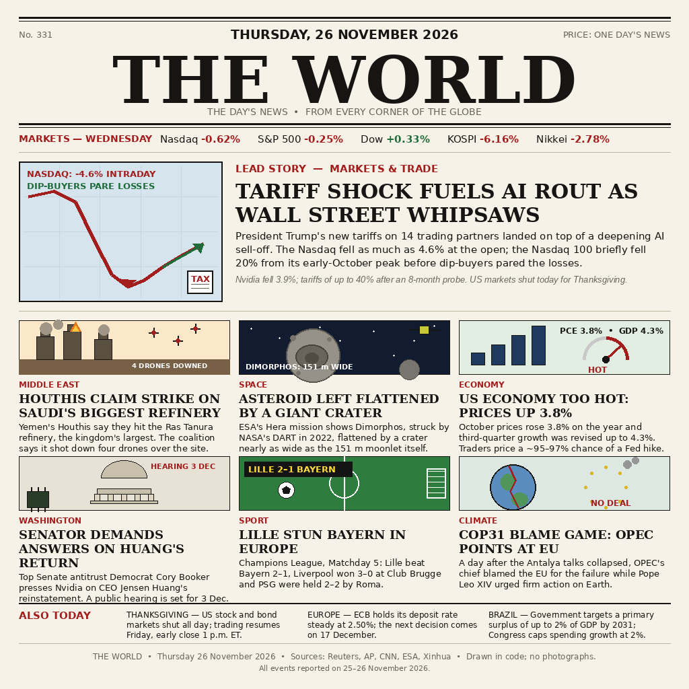

# THE WORLD — Thursday 26 November 2026


Entry for the [news-image-20261126 bounty](https://make.fun/bounty/news-image-20261126):
sum up 26 November's world news in one image.



## The front page

A code-drawn newspaper front page, **THE WORLD**, dated Thursday
26 November 2026.

- **Lead story:** tariff shock fuels an AI rout as Wall Street whipsaws —
  the Nasdaq fell as much as 4.6% at the open and the Nasdaq 100 briefly
  dropped 20% from its early-October peak, on Trump's new tariffs on
  14 trading partners.
- **Grid:** Houthis claim a strike on Saudi Arabia's biggest refinery;
  ESA's Hera shows the asteroid Dimorphos flattened by a giant crater;
  the US economy runs hot (prices up 3.8%, growth revised to 4.3%);
  a senator demands answers on Jensen Huang's return to Nvidia; Lille
  stun Bayern Munich in the Champions League; the COP31 blame game as
  OPEC points at the EU.
- **Also today:** US markets shut for Thanksgiving, the ECB holds at
  2.50%, Brazil targets a primary surplus of up to 2% of GDP by 2031.

Every illustration is drawn in code — no photographs, no network.

## Files

| File | What it is |
| --- | --- |
| `entry.png` | The poster, 1024 x 1024, 157,044 bytes |
| `draw_poster.py` | The program that draws the poster (Pillow) |
| `main.py` | Stdlib-only entrypoint: copies `entry.png` to the output directory and verifies size and sha256 |
| `RESEARCH.md` | The facts behind every story, and what was deliberately left out |
| `BUILD.md` | Layout plan and build notes |

## Run it

```sh
python3 draw_poster.py        # redraw entry.png
MAKEFUN_OUTPUT_DIR=out python3 main.py   # copy it to out/entry.png
```

## Sources

Reuters, AP, CNN, ESA, Xinhua. See `RESEARCH.md` for the facts and for
the figures that were left out because sources conflicted.
